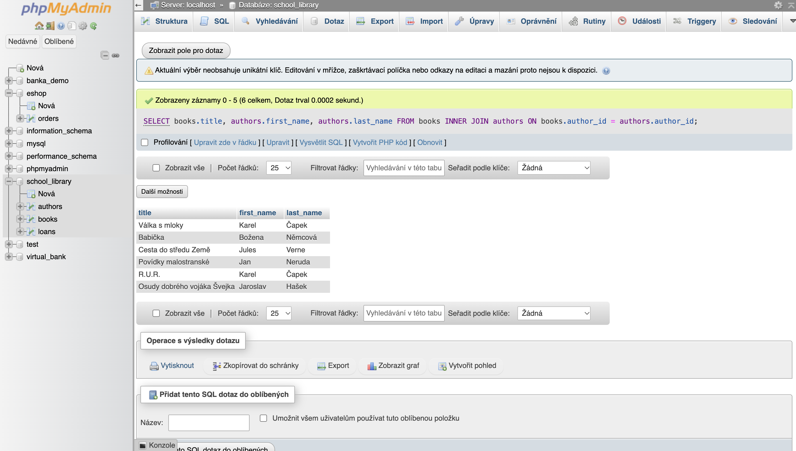
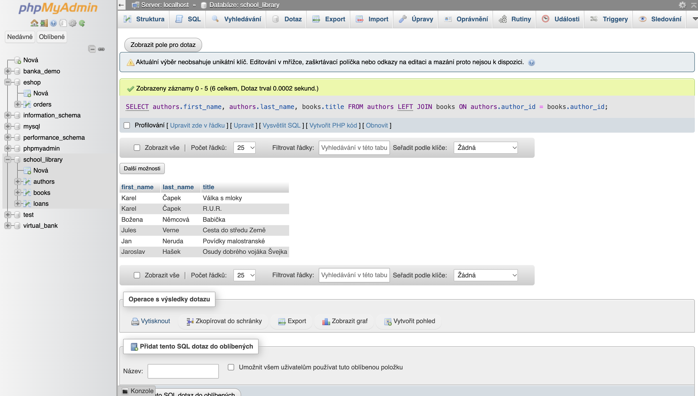
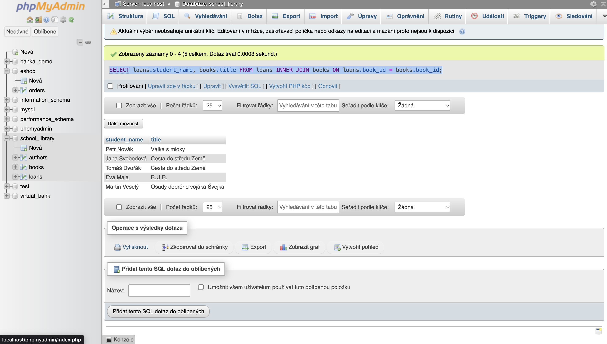
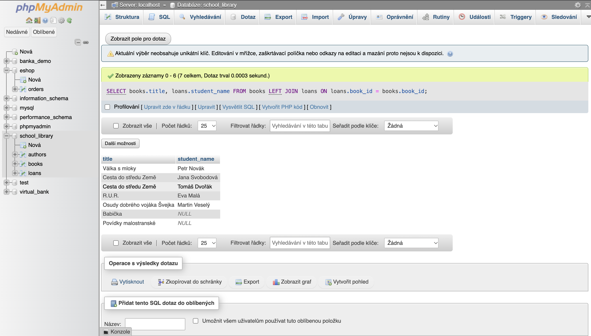

# Join - Štěpán Hodboď 3IT

## uloha 1
``` sql
SELECT books.title, authors.first_name, authors.last_name
FROM books
INNER JOIN authors ON books.author_id = authors.author_id;
```


## Uloha 2
```sql
SELECT authors.first_name, authors.last_name, books.title 
FROM authors 
LEFT JOIN books ON authors.author_id = books.author_id;
```

## uloha 3
```sql
SELECT loans.student_name, books.title 
FROM loans 
INNER JOIN books ON loans.book_id = books.book_id;
```

## uloha 4
```sql
SELECT books.title, loans.student_name 
FROM books 
LEFT JOIN loans ON loans.book_id = books.book_id;
```


## uloha 5
```sql
SELECT authors.first_name, authors.last_name, books.title
FROM books
RIGHT JOIN authors ON authors.author_id = books.author_id;
```
